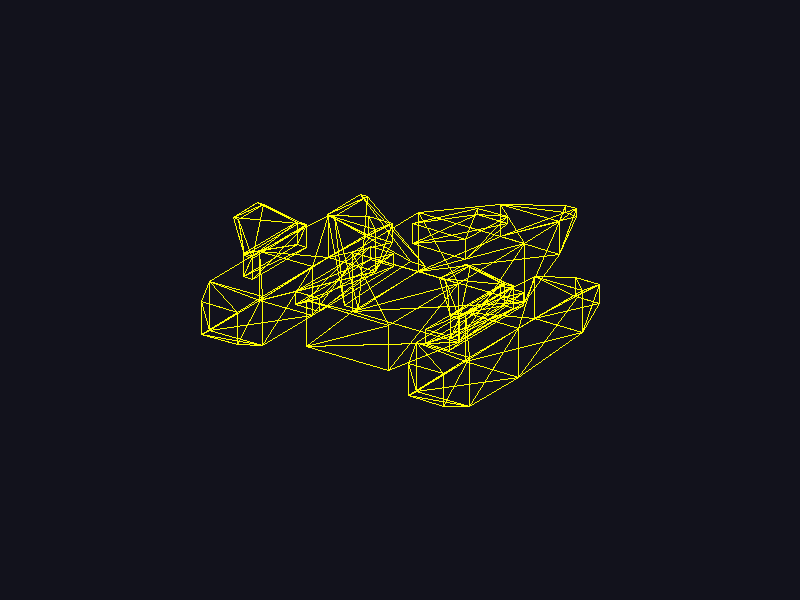

# Software Renderer — Modelo OBJ en Wireframe

**Autor:** Samuel Robledo
**Universidad del Valle de Guatemala** — Gráficas por Computadora



## Descripción

Renderer por software escrito en C++17 que carga un modelo en formato Wavefront `.obj` y lo dibuja en wireframe.
Todo se pinta píxel por píxel en un framebuffer propio: no se usa OpenGL ni las primitivas de dibujo de SDL.
SDL2 solo se encarga de abrir la ventana y mostrar el framebuffer como textura, y GLM aporta los tipos vectoriales y matriciales.

El modelo es una nave espacial que se presenta con una rotación fija (25° en X y -35° en Y) para verla en perspectiva de 3/4.
Después se centra y se escala automáticamente según su bounding box.

## Pipeline

1. **Lectura del OBJ** — `loadOBJ` interpreta las líneas `v` y `f` (formatos `v`, `v/vt`, `v//vn`, `v/vt/vn`, índices negativos y finales de línea `\r\n`).
2. **Caras** — los polígonos de 4 o más vértices se triangulan en abanico.
3. **Índices** — cada `Face` guarda los índices de sus tres vértices en base 0.
4. **Vértices** — `setupVertexArray` recorre las caras y obtiene los `glm::vec3` correspondientes.
5. **Transformación a pantalla** — rotación fija, centrado según el bounding box, escala uniforme al 70% de la dimensión menor de la ventana e inversión del eje Y.
6. **Triángulos** — `render` recorre `vertexArray` de 3 en 3 y llama `triangle(A, B, C)`.
7. **Líneas Bresenham** — cada arista se rasteriza con aritmética entera.
8. **Framebuffer** — los píxeles se escriben en un `std::vector<Color>` de 800×600.
9. **SDL** — el framebuffer se copia a una textura `RGB24` y se presenta en la ventana.

## Estructura del proyecto

```
lab4/
├── CMakeLists.txt
├── README.md
├── .gitignore
├── assets/
│   └── model.obj
├── screenshots/
│   └── render.png
├── include/
│   ├── color.h
│   ├── framebuffer.h
│   ├── line.h
│   ├── triangle.h
│   ├── face.h
│   ├── objloader.h
│   └── stb_image_write.h
└── src/
    ├── main.cpp
    ├── framebuffer.cpp
    ├── line.cpp
    ├── triangle.cpp
    └── objloader.cpp
```

## Requisitos

- Compilador con soporte C++17 (g++ 9 o superior)
- CMake 3.16 o superior
- SDL2
- GLM

En Ubuntu / WSL2:

```bash
sudo apt install -y build-essential cmake pkg-config libsdl2-dev libglm-dev
```

## Compilar y ejecutar

Desde la carpeta `lab4/` (probado en WSL2 con Ubuntu y WSLg):

```bash
cmake -S . -B build
cmake --build build
./build/renderer
```

El programa debe ejecutarse desde `lab4/`, porque las rutas `assets/model.obj` y `screenshots/render.png` son relativas a esa carpeta.
Al dibujar el primer frame se guarda automáticamente la captura en `screenshots/render.png`.

## Controles

| Tecla | Acción |
|-------|--------|
| `S`   | Guarda una captura en `screenshots/render.png` |
| `ESC` | Cierra la ventana |
